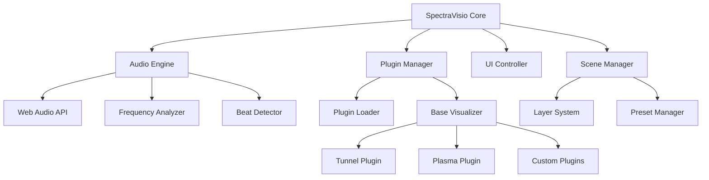

# 🌈 SpectraVisio

> **Professional Audio Visualizer for Web Browsers**  
> Real-time music visualization with customizable plugins and stunning effects

[](https://opensource.org/licenses/MIT)
[](https://developer.mozilla.org/en-US/docs/Web/API/Web_Audio_API)
[](https://developer.mozilla.org/en-US/docs/Web/API/Canvas_API)
[](https://web.dev/progressive-web-apps/)

---

## ✨ **Features**

### 🎵 **Audio Processing**
- **Real-time frequency analysis** with 7-band splitting
- **Stereo channel processing** for immersive effects  
- **Beat detection** with tempo synchronization
- **Dynamic range compression** for consistent visuals
- **Low-latency processing** optimized for live performance

### 🎨 **Visualization Engine**
- **18+ Built-in visualizations** from simple to complex
- **Plugin-based architecture** for easy extensibility
- **Layer system** with blending modes and effects
- **Scene management** with snapshot/restore functionality
- **Performance scaling** adapts to device capabilities

### 🔧 **Professional Tools**
- **Live parameter control** with MIDI mapping support
- **Preset management** with import/export
- **Performance monitoring** with FPS and load metrics
- **Fullscreen mode** optimized for live performances
- **Mobile responsive** design for all devices

---

## 🚀 **Quick Start**

### 🌐 **Try It Live**
**Demo:** [spectravisio.github.io](https://spectravisio.github.io) *(Coming Soon)*

### 📦 **Installation**

```bash
# Clone the repository
git clone https://github.com/username/spectravisio.git
cd spectravisio

# Install dependencies
npm install

# Start development server
npm run dev

# Build for production
npm run build
```

### 🎯 **Basic Usage**

```javascript
import { SpectraVisio } from './src/core/SpectraVisio.js';

// Initialize visualizer
const visualizer = new SpectraVisio({
    canvas: document.getElementById('canvas'),
    width: 1920,
    height: 1080
});

// Load a plugin
await visualizer.pluginManager.loadPlugin('tunnel');

// Start visualization
visualizer.start();
```

---

## 🎨 **Available Visualizations**

| Plugin | Complexity | Performance | Description |
|--------|------------|-------------|-------------|
| **Tunnel** | Medium | High | 3D tunnel effect with frequency-responsive geometry |
| **Plasma** | High | Medium | Fluid plasma simulation with color morphing |
| **Ribbons** | Low | Very High | Flowing ribbon particles with smooth trails |
| **Oscilloscope** | Low | Very High | Classic waveform display with customizable styles |
| **Spectrum Bars** | Low | Very High | Traditional frequency bars with 3D effects |
| **Particle Storm** | Medium | Medium | Dynamic particle system with physics |
| **Kaleidoscope** | Medium | High | Symmetric mandala patterns with rotation |

*See [Visualizations Documentation](SpectraVisio_Visualizations.md) for complete specifications*

---

## 📚 **Documentation**

### 📖 **Core Documentation**
- [📋 Product Requirements](SpectraVisio_PRD.md) - Project vision and roadmap
- [⚙️ Technical Design](SpectraVisio_TDD.md) - Architecture and implementation details
- [🔌 API Reference](SpectraVisio_API_Reference.md) - Complete API documentation
- [🎨 Visualizations Spec](SpectraVisio_Visualizations.md) - All visualization details

### 🛠️ **Development Guides**
- [🔧 Plugin Development](SpectraVisio_Plugin_Development_Guide.md) - Create custom visualizations
- [🚀 Deployment Guide](SpectraVisio_Deployment_Guide.md) - Production deployment setup
- [🤖 AI Development Practices](claude.md) - Claude-assisted development workflow

### 👥 **Community**
- [📖 User Manual](SpectraVisio_User_Manual.md) - Complete user guide
- [🤝 Contributing Guidelines](SpectraVisio_Contributing_Guidelines.md) - How to contribute
- [💬 Discord Community](https://discord.gg/spectravisio) *(Coming Soon)*

---

## 🏗️ **Architecture Overview**



### 🔧 **Tech Stack**
- **Framework:** Vanilla JavaScript ES6+ with Web Components
- **Audio:** Web Audio API with stereo processing
- **Graphics:** Canvas 2D (WebGL optional for advanced effects)
- **Architecture:** Plugin-based with event-driven communication
- **Build:** Webpack 5 with Babel for browser compatibility
- **Testing:** Jest with Puppeteer for integration tests

---

## 🎯 **Performance**

### ⚡ **Benchmarks**
- **60 FPS** at 1920x1080 on mid-range hardware
- **<50ms latency** from audio input to visual output
- **<5% CPU usage** for simple visualizations
- **<200MB memory** footprint with 10+ plugins loaded
- **Mobile optimized** with adaptive quality scaling

### 📊 **Browser Support**
- ✅ **Chrome 80+** (Recommended)
- ✅ **Firefox 75+**
- ✅ **Safari 14+**
- ✅ **Edge 80+**
- ⚠️ **Mobile browsers** (Limited WebGL support)

---

## 🚧 **Development Status**

### 🎯 **Current Phase: Foundation Development**

- [x] **Phase 0:** Complete Documentation Suite *(100%)*
- [ ] **Phase 1:** Core Framework *(In Progress)*
- [ ] **Phase 2:** Base Plugins
- [ ] **Phase 3:** Advanced Features
- [ ] **Phase 4:** Production Release

### 📅 **Roadmap 2026**

| Quarter | Milestone | Features |
|---------|-----------|----------|
| **Q1** | Alpha Release | Core framework + 3 base plugins |
| **Q2** | Beta Release | Full plugin suite + mobile support |
| **Q3** | V1.0 Release | Production-ready + community features |
| **Q4** | V1.1 Release | Advanced effects + MIDI integration |

*See [Product Requirements](SpectraVisio_PRD.md) for detailed roadmap*

---

## 🤝 **Contributing**

We welcome contributions from the community! 

### 🔰 **Quick Start for Contributors**
1. **Fork** the repository
2. **Read** our [Contributing Guidelines](SpectraVisio_Contributing_Guidelines.md)
3. **Setup** development environment
4. **Create** feature branch: `git checkout -b feature/amazing-visualization`
5. **Follow** our [coding standards](SpectraVisio_Contributing_Guidelines.md#coding-standards)
6. **Submit** pull request with detailed description

### 🎨 **Ways to Contribute**
- 🔌 **Create new visualization plugins**
- 🐛 **Report bugs and issues**
- 📚 **Improve documentation**
- 🧪 **Write tests and benchmarks**
- 🎵 **Test with different audio sources**
- 💬 **Help in community discussions**

---

## 🏆 **Recognition**

### 🌟 **Featured In**
- *Coming Soon* - Web Audio Conference 2026
- *Coming Soon* - Chrome Developer Blog
- *Coming Soon* - JavaScript Weekly

### 🏅 **Awards**
- *Coming Soon* - Best Open Source Audio Tool 2026

---

## 📄 **License**

This project is licensed under the **MIT License** - see the [LICENSE](LICENSE) file for details.

### 🙏 **Acknowledgments**
- **Web Audio API** team for the amazing browser audio capabilities
- **Canvas API** developers for high-performance 2D graphics
- **Open source community** for inspiration and feedback
- **Audio visualization pioneers** who paved the way

---

## 📞 **Contact & Support**

- 💬 **Discord:** [Join our community](https://discord.gg/spectravisio) *(Coming Soon)*
- 🐛 **Issues:** [GitHub Issues](https://github.com/username/spectravisio/issues)
- 📧 **Email:** spectravisio@example.com *(Coming Soon)*
- 🐦 **Twitter:** [@SpectraVisio](https://twitter.com/spectravisio) *(Coming Soon)*

---

<div align="center">

**Made with ❤️ by the SpectraVisio Community**

⭐ **Star us on GitHub if you like this project!** ⭐

*Transform your music into visual art*

</div>