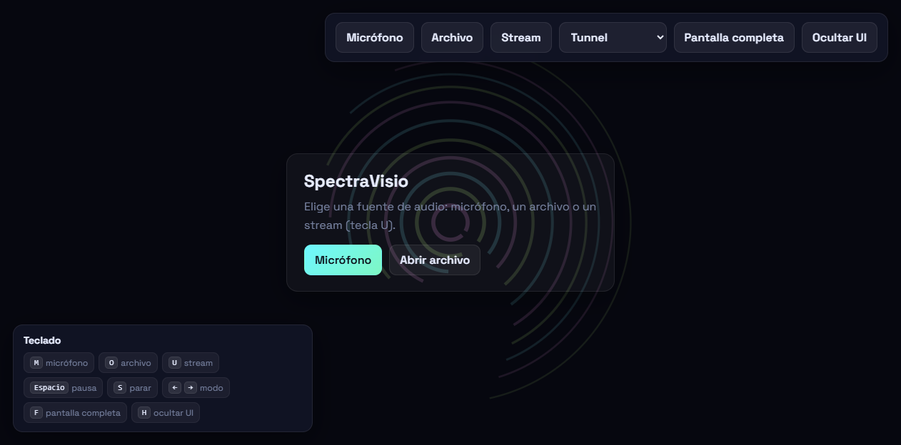
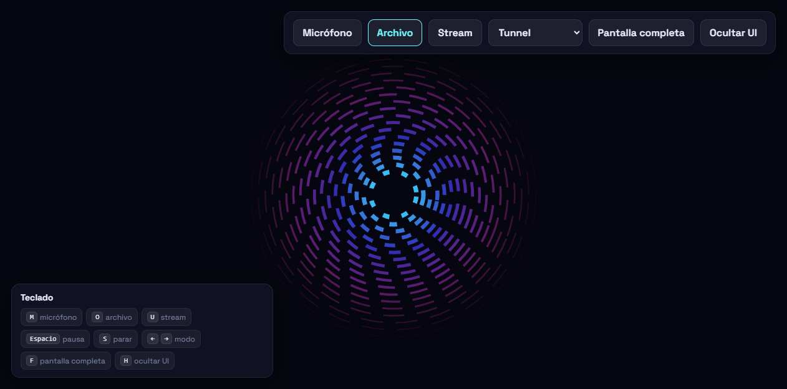
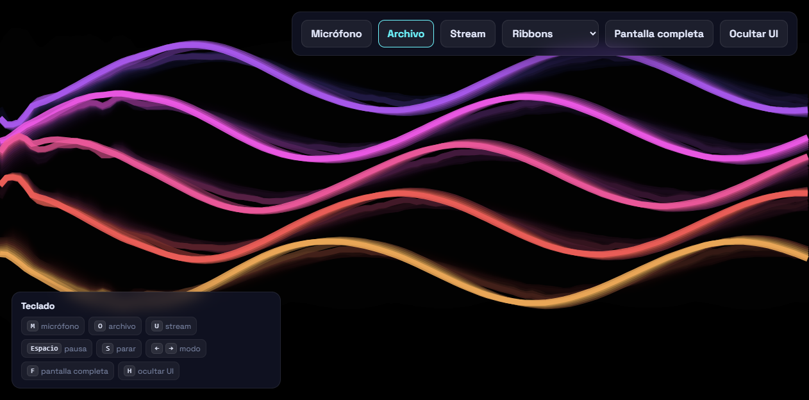
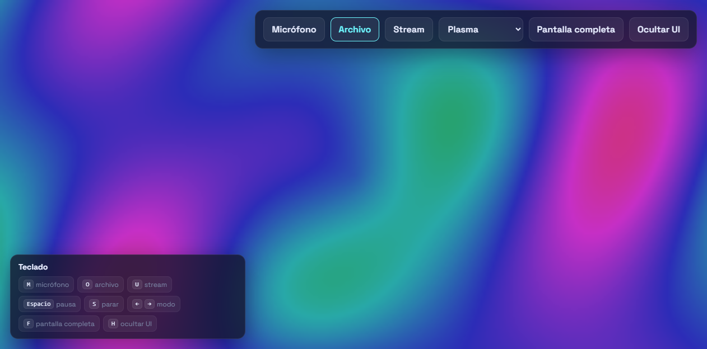
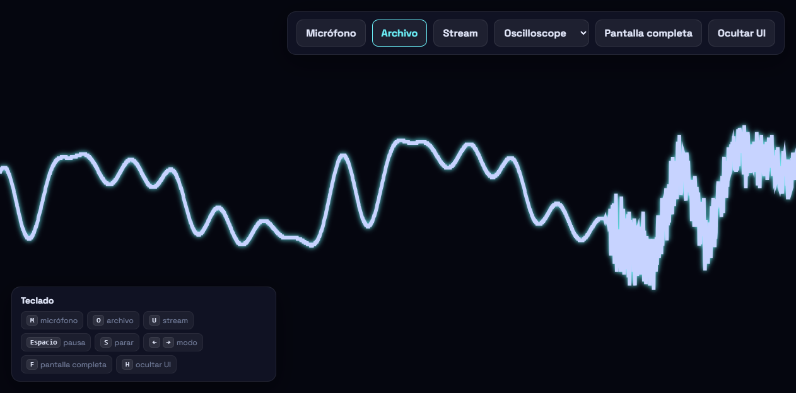
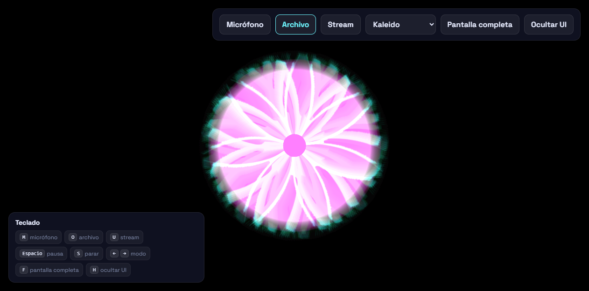
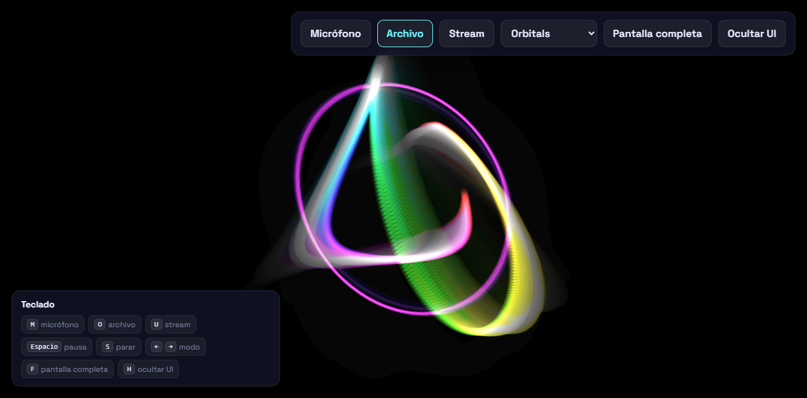
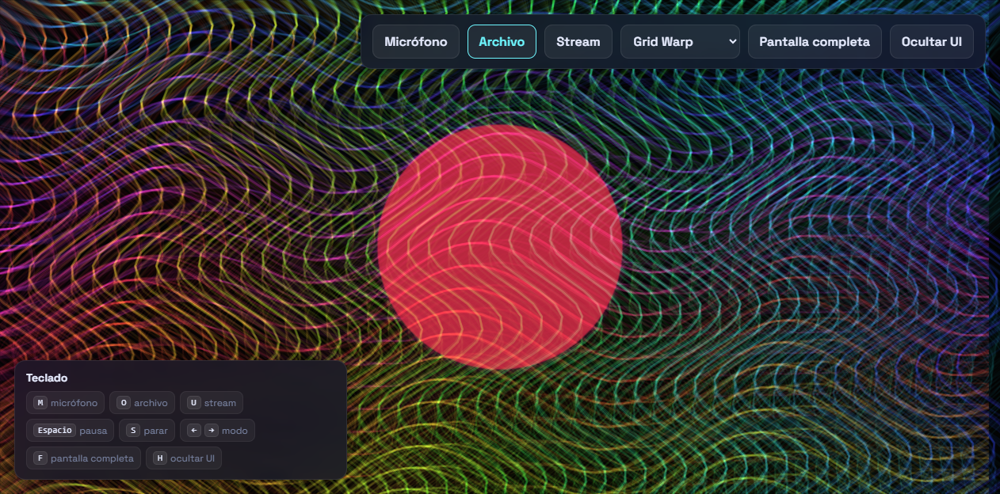
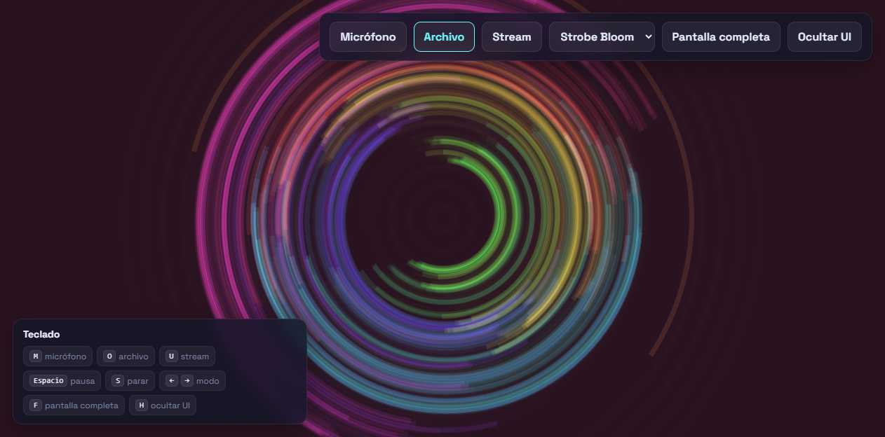

# SpectraVisio

Real-time audio visualizer for the browser. Canvas 2D and the Web Audio API, plain JavaScript, built with Vite.

[](LICENSE)

| Welcome (idle) | Tunnel | Ribbons |
|---|---|---|
|  |  |  |
| **Plasma** | **Oscilloscope** | **Kaleido** |
|  |  |  |
| **Orbitals** | **Grid Warp** | **Strobe Bloom** |
|  |  |  |

Screenshots taken with a synthetic test track.

## Features

- Audio sources: microphone, local audio file, or stream URL
- Microphone input with echo cancellation, noise suppression and auto gain turned off, so music reaches the analyser unaltered
- Streams must be served with CORS headers; without them the browser blocks analysis
- Bass, mid and treble bands, overall energy and a simple beat detector
- Eight visualizations, switchable while playing
- Animation speed independent of the display refresh rate; HiDPI rendering capped at 2x
- Fullscreen and hideable interface

## Visualizations

| Name | What it draws | Driven by |
|---|---|---|
| Tunnel | Dashed rings flying towards the viewer | Energy (speed), bass (size), mid (rotation), treble (hue) |
| Ribbons | Five wave lines with trails | Low spectrum, energy, bass (width) |
| Plasma | Sine interference field | Mid (speed), bass and treble (hue) |
| Oscilloscope | Waveform | Waveform, energy, bass, beat (colour and glow) |
| Kaleido | Mirrored radial spectrum bars | Spectrum, bass, mid, treble (segments) |
| Orbitals | Particles on Lissajous-like orbits | Waveform, bass, mid, treble (count and size) |
| Grid Warp | Distorted line grid | Bass and mid (amplitude), treble (swirl) |
| Strobe Bloom | Petal arcs with a soft flash on transients | Energy jumps; the flash is capped well below a hard strobe |

## Controls

| Key | Action |
|---|---|
| `M` | Microphone |
| `O` | Open audio file |
| `U` | Stream URL |
| `Space` | Pause / resume |
| `S` | Stop the source |
| `Left` / `Right` | Previous / next visualization |
| `F` | Fullscreen |
| `H` | Hide / show the interface |

The same actions are available as buttons, except pause and stop.

## Run

Requires Node.js 18 or later.

```bash
npm install
npm run dev       # development server
npm run build     # production build in dist/
npm run preview   # serve the build
```

## Structure

```
index.html                 Page markup
src/main.js                UI wiring, keyboard, render loop
src/core/audioEngine.js    Sources, analyser, bands, beat detection
src/core/pluginManager.js  Registry and active visualization
src/core/capabilities.js   Browser feature checks
src/plugins/               One file per visualization
```

## Adding a visualization

Extend `BaseVisualizer`, implement `render(data)` and add the class to `MODES` in `src/main.js`.

`data` carries `frequencyData` (1024 bins), `timedomainData` (2048 samples), `bass`, `mid`, `treble` and `energy` (0 to 1), `beat`, `dt` (seconds since the last frame) and `time`. `BaseVisualizer` provides `width`, `height`, `dpr`, `clear()`, `fade(alpha, dt)` and `driftHue(data)`.

## Original specification

`docs/archive/` holds the January 2026 specification documents and the single-file prototype the app grew from. They describe a much larger product (MIDI, layers, scenes, presets, PWA) that was never built.

## License

GPL-3.0. See [LICENSE](LICENSE).

## Credits

Developed by [@memoriainfinita](https://github.com/memoriainfinita) with the assistance of Claude Sonnet 4.6 (Anthropic).
