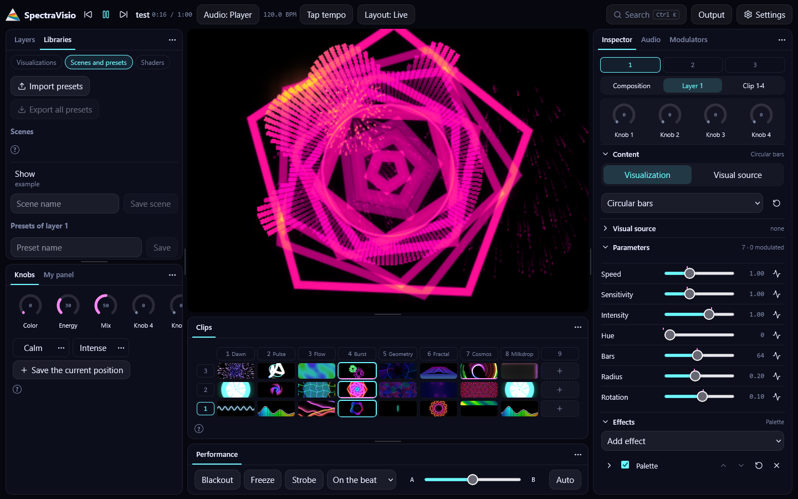

# SpectraVisio guide

How to use SpectraVisio, by what you want to do. The [README](../../README.md) lists everything the app does; these pages are short walks through it.

Open https://memoriainfinita.github.io/Spectra-visio/. Everything stays in your browser: there is no account, and nothing is uploaded. It works in Firefox and Chrome (Edge too); Safari is not supported.

The screen has the stage in the middle, with the layers and the libraries on the left, the Inspector, the audio and the modulators on the right, and your clips and the performance bar under the stage. The first time, a notice about flashing images asks you to continue; **Settings › Accessibility** has a flash limiter.

## I want to…

| I want to… | Page |
|------------|------|
| Play music, or use the microphone, a tab, a radio or a stream | [Play music and pick a source](play-music.md) |
| See everything the app does at once | [Try the example scene](example-scene.md) |
| Build my own picture from layers, clips, effects and a camera or video | [Compose your own](compose.md) |
| Make parameters move with the music, or put them on a knob | [Make it move with the music](modulate.md) |
| Run a live show: crossfader, columns, strobe, MIDI, a projector | [Perform live](perform.md) |
| Send the image to OBS, or record it | [OBS and recording](obs-and-recording.md) |

## If something does not work

- **No sound analysis from the microphone or a tab:** the browser asks for permission the first time; if you denied it, allow it again from the lock next to the address.
- **A radio does not react:** the radio must allow CORS; the ones that do not can be heard in a player but not analysed.
- **The image is slow:** **Settings › Performance** has adaptive quality, a frame rate limit and a low power mode.
- **You want your settings in another browser:** **Settings › Backup** exports and imports them, with the presets, scenes, shaders and layouts.
