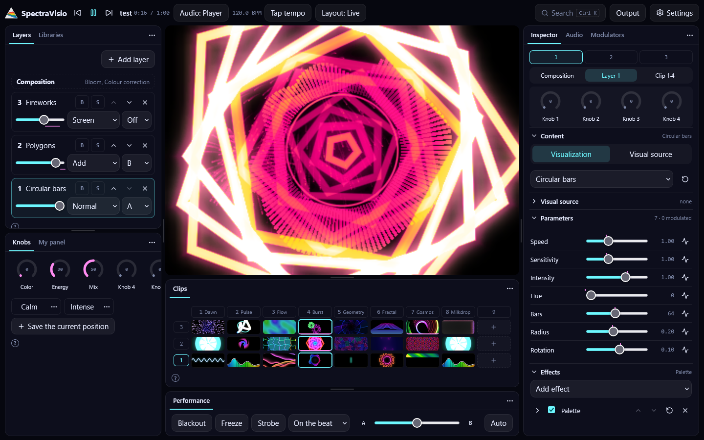
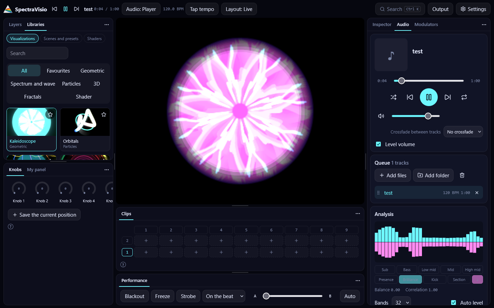
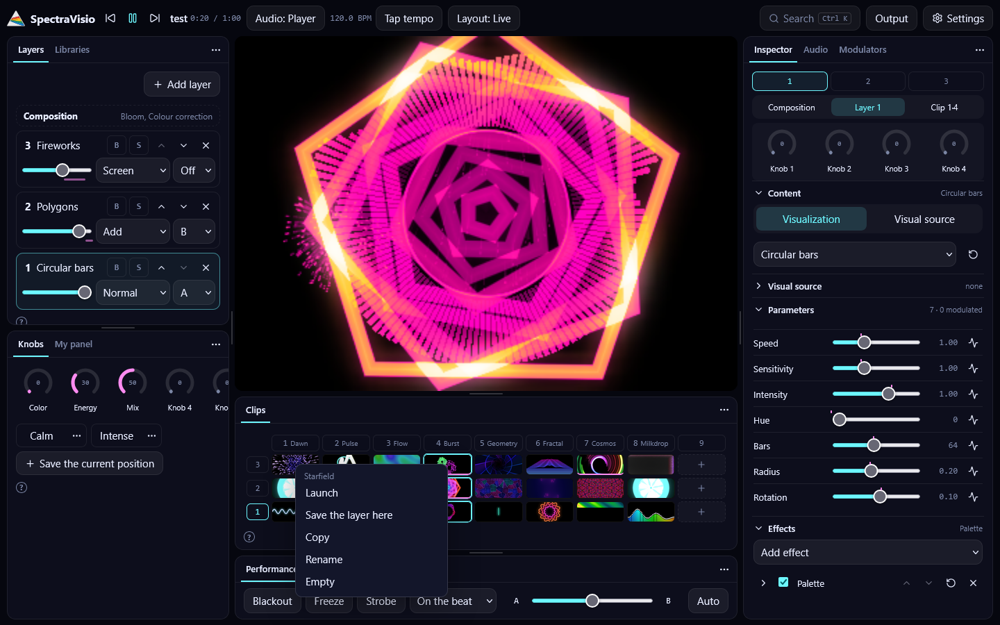

# Compose your own

A scene is a stack of layers, each showing one visualization or one visual source, with effects on a layer and on the whole composition.

## Layers

The **Layers** tab lists them, the top one first. **Add layer** puts a new one on top (up to eight).

- The slider is the layer's **opacity**; the menu next to it says how it **blends** onto the layers below (normal, add, screen…)
- The last menu is the **crossfader side**: A, B or off. The slider in the performance bar fades between the two sides
- **B** bypasses the layer and **S** plays it alone; the arrows move it up or down and the cross removes it
- **Composition** at the top holds the effects that act on the whole image

Click a layer to edit it in the **Inspector** on the right.

## Pick a visualization

**Libraries › Visualizations** is the browser, with thumbnails, categories, search and favourites. Clicking one puts it on the selected layer.

There are 21 built-in ones, plus Milkdrop presets and shaders you import (ISF or Shadertoy-style code) in **Libraries › Shaders**, with four examples written for the app. Imported shaders are put on a layer from the same browser.

## Set it up in the Inspector

The **Inspector** has three levels: **Composition**, **Layer** and **Clip**. On a layer you choose the content (**Visualization** or **Visual source**), edit its parameters and add effects. The effects are bloom, feedback, trails, mirror, kaleidoscope, colour correction, palette and a mix with the visual source, and they apply in the order of the list.

## Use a camera, a video or an image

In the Inspector, on a layer, set **Content** to **Visual source** (or open the **Visual source** section to keep it under a visualization). It takes a camera, an image or video file, a live TV channel from the iptv-org lists, or free videos and images from Wikimedia Commons and NASA. The shaders and the **Mix with source** effect read it. Videos have position, trim, direction, loop and speed; a video or a channel can have its own sound, off by default, mixed with the music.

## Clips

The clip grid under the stage keeps what a layer shows, one cell per column. Click an empty cell (or `Shift` + click) to save the layer there, click a clip to launch it, and right click for the menu.

A clip keeps the visualization, its parameters and its effects. In the Inspector, on the **Clip** level, you can set it to launch **On the beat** instead of at once, and then it waits for the next beat. Columns have names (right click on the number) and are launched with `1` to `9`.

## Overlays

Track title, synced lyrics, text and a logo go on top of the image. They are in **Inspector › Composition › Overlays**.
