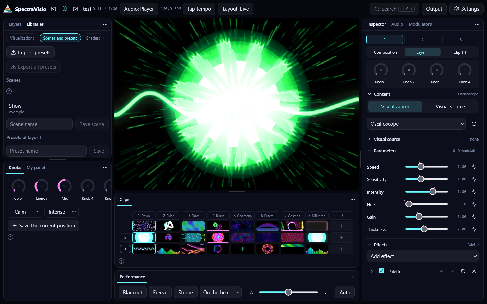

# Try the example scene

The quickest way to see what SpectraVisio does is to load its example scene, **Show**. It uses every visualization and every effect, and it moves by itself even without music.

## Load it

Open **Libraries › Scenes and presets** on the left and click **Show**. It replaces the current scene; `Ctrl Z` brings yours back.

## Play with it

- **Launch a column.** The clip grid has eight named columns (Dawn, Pulse, Flow, Burst, Geometry, Fractal, Cosmos, Milkdrop). Click a column number, or press `1` to `8`, and every layer changes to that moment. Each has a palette of its own and shows one thing: oscillators, beats, a band of the spectrum, clips that wait for the beat, the mirror, the kaleidoscope, feedback
- **Crossfader.** Layer 1 is on side A and layer 2 on side B; the slider in the performance bar moves from one to the other. Layer 3 stays on top of both
- **Knobs.** Under the layers, **Color** turns the hue of the whole image, **Energy** raises the glow and the third layer, and **Mix** moves the crossfader. **Calm** and **Intense** are variations: they take the knobs there at once or over a few beats
- **Modulators.** In the **Modulators** tab on the right, *Breath*, *Pulse* and *Bass* move parameters with an oscillator, the kick and the low band
- **My panel.** The tab next to the knobs collects the controls you would use in a show: knobs, variations, blackout, freeze, strobe and the crossfader

The [next pages](README.md) explain each of those on its own.

## Keep your own

**Save scene** stores the whole composition (layers, clips, effects, knobs and modulators) under the name you type. Saved scenes are listed here, load with one click and go into the backup file. **Presets of layer** (below) save one layer with its effects instead.
