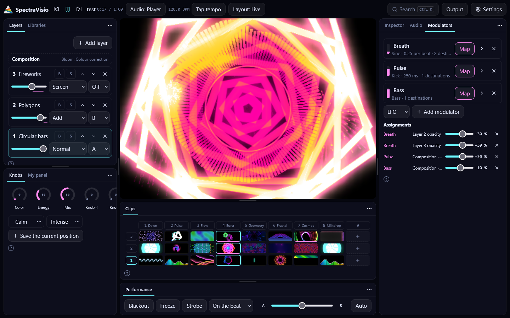
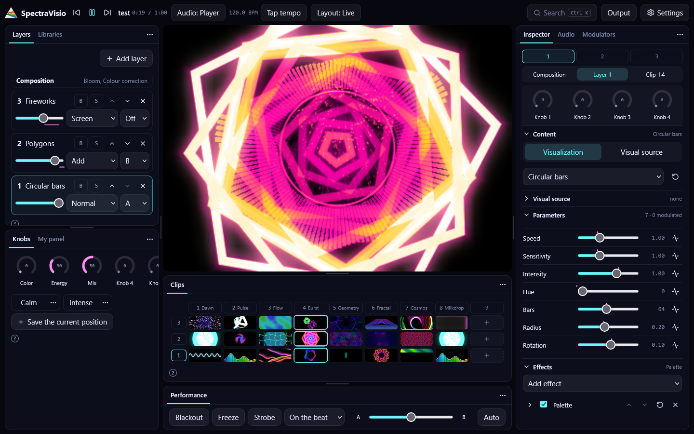
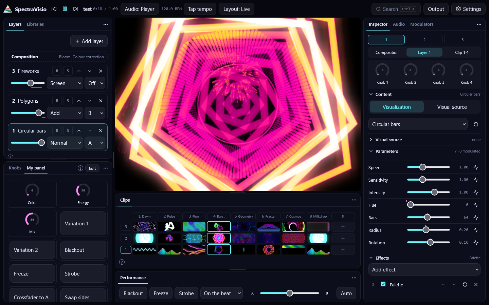

# Make it move with the music

Any parameter of a visualization or an effect can follow the sound, an oscillator or a MIDI control. You can also group parameters on a knob, and put the controls you use in a panel of your own.

## Modulate a parameter

Next to every parameter in the Inspector there is a small wave icon. Click it to connect the parameter to a source:

- **Band:** one band of the spectrum, from sub-bass to brilliance, with a curve and smoothing
- **Beat:** the hits of a band, or of the kick or the sections of the track, with a decay
- **Oscillator:** a slow wave (sine, triangle, saw, square) that follows the tempo or runs free
- **MIDI:** a control you move on your keyboard or controller

The amount is set by dragging on the parameter's own slider while you map it. A layer's opacity can be modulated too. The Parameters header counts how many are modulated.

## Shared modulators

The **Modulators** tab on the right holds up to eight modulators that drive several parameters at once. **Add modulator** creates one, and **Map** lights up every control it can reach: click one to connect it, and the **Assignments** list shows each connection with its amount.

## Knobs and variations

The **Knobs** tab under the layers has eight knobs. Right click a parameter, an effect, a layer opacity or the crossfader and choose **Put on a knob**: the knob then moves it, over a range you set (and inverted if you want). **Save the current position** stores where the knobs are as a variation, and clicking it later brings them back at once or over a few beats.

## My panel

**My panel**, next to the knobs, is a grid for the controls you reach for in a show. Press **Edit**, drag any control of the app into a cell (knobs, variations, blackout, freeze, strobe, the crossfader and more) and press **Done**.

## MIDI

Turn on MIDI in **Settings › MIDI** and pick the input; the browser asks for permission. Then right click any control and choose **Learn**, and move the control on your device: from then on it drives that control. The mappings are listed there, where they can be removed. The app can also follow an external MIDI clock for the tempo.
