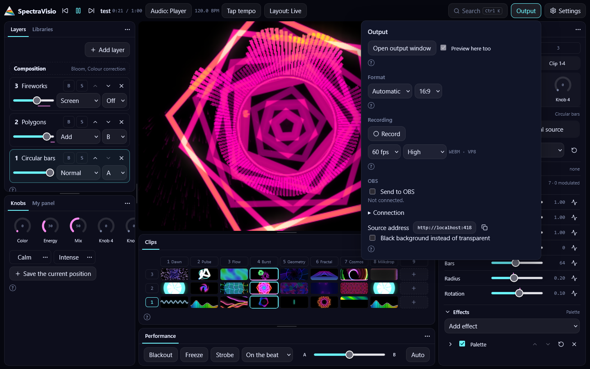

# OBS and recording

## Send the image to OBS

SpectraVisio draws the image in a **browser source** of OBS. The app has to stay open in a browser: it sends the analysis and the controls to the source through obs-websocket.

1. In OBS, make sure the WebSocket server is on (**Tools › WebSocket Server Settings**; OBS 28 and later include it) and note its port and password
2. In SpectraVisio, open **Output** in the top bar. Under **OBS**, turn on **Send to OBS**. Under **Connection** put the address of OBS and its password and press **Save and connect**
3. Copy the **Source address** with the button next to it, and in OBS add a **Browser** source with that address. It has a transparent background; **Black background instead of transparent** changes that

If the source says it is waiting, the connection is not made yet. Once it is, the OBS source shows the image and follows the app.

- **The sound does not go through the source.** Capture it in OBS apart, for example with an application audio capture of the browser
- **From the web version (GitHub Pages):** the browser may ask for permission to reach your local network, because OBS runs on your computer. Allow it
- **Resolution:** **Format** in the same menu fixes it from automatic up to 4K

## Record

Under **Recording**, press **Record**, choose the frames per second and the quality, and press **Stop** to get the video with its sound. The format is WebM; the file is downloaded when you stop, and the last one is kept in the browser in case the download is cancelled.

## Stream without OBS

For a call or a stream that captures a window or a tab, the **Open output window** button gives a clean window with only the image, and [Perform live](perform.md) explains how to use it.
