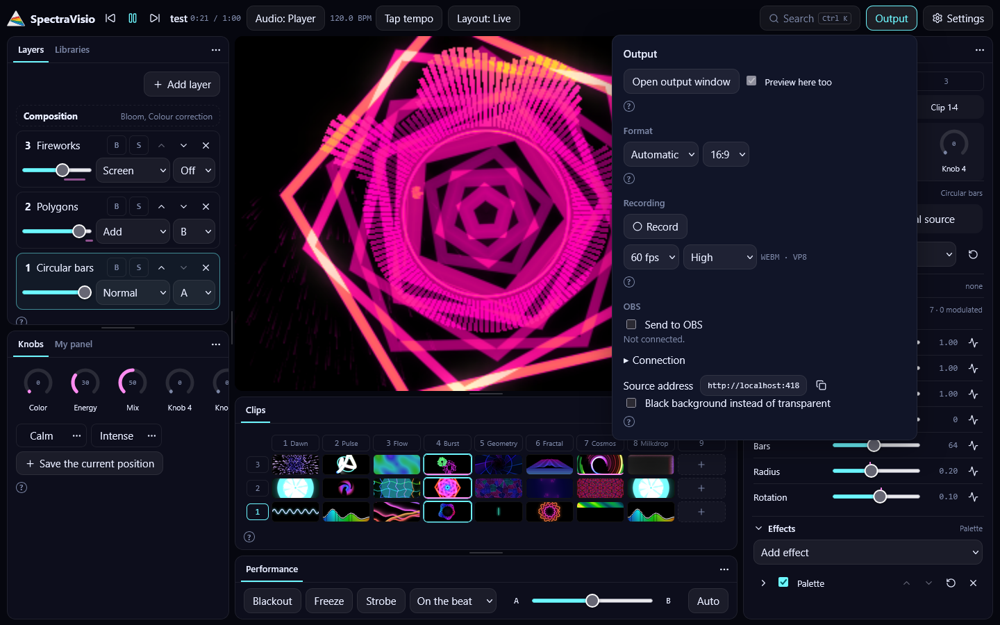
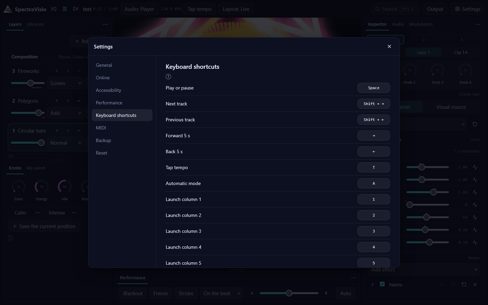

# Perform live

SpectraVisio is meant to be played: everything below works from the keyboard, with a mouse or from a MIDI controller.

## The performance bar

Under the clip grid:

- **Blackout** darkens the image (and the text overlays), **Freeze** holds the frame, and **Strobe** flashes white at the rate you pick: on the beat, or a number of times per second, never more than three
- The **crossfader** fades between the layers on side A and the ones on side B. Its end points and a swap are on `Z`, `C` and `X`
- **Auto** changes visualizations by itself, by time, on the beat or when the track changes; its settings are in **Inspector › Composition**

## Columns and clips

Each column of the grid launches one clip on every layer. Name a column with a right click on its number, give it a MIDI note there, and launch it with `1` to `9`, with the click or with the note. Clips can wait for the beat, and the **Transition** setting fades from one clip to the next.

## Shortcuts

Every action has a key, listed and editable in **Settings › Keyboard shortcuts**: click a key and press the new one.

`Space` plays or pauses, `T` taps the tempo, `A` turns Auto on, `B`, `F` and `S` are blackout, freeze and strobe. With **Reduce flashes** in Settings › Accessibility the strobe is turned off and the image is limited so it does not flash more than three times a second. That limiter follows the WCAG guideline but it is not certified.

## A projector or a second screen

**Output** in the top bar has **Open output window**: a window with only the image that you move to the projector and put in full screen with a double click. Keep it visible, because a minimized window makes the browser slow the analysis down. The main window controls it, and the shortcuts work in both.

## Layouts

The panels of the screen move: drag a tab to another dock, or use the dock's menu. The **Layout** button in the top bar has built-in layouts for a show, for preparing, for two screens and for laptops, lets you save your own and lock the current one, and any panel can open in a window of its own.
