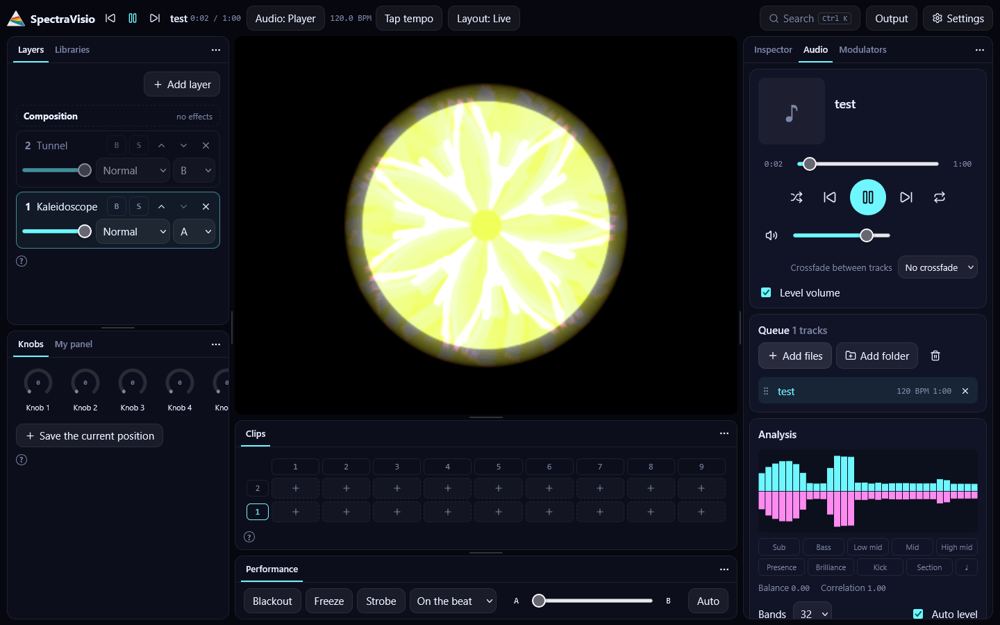
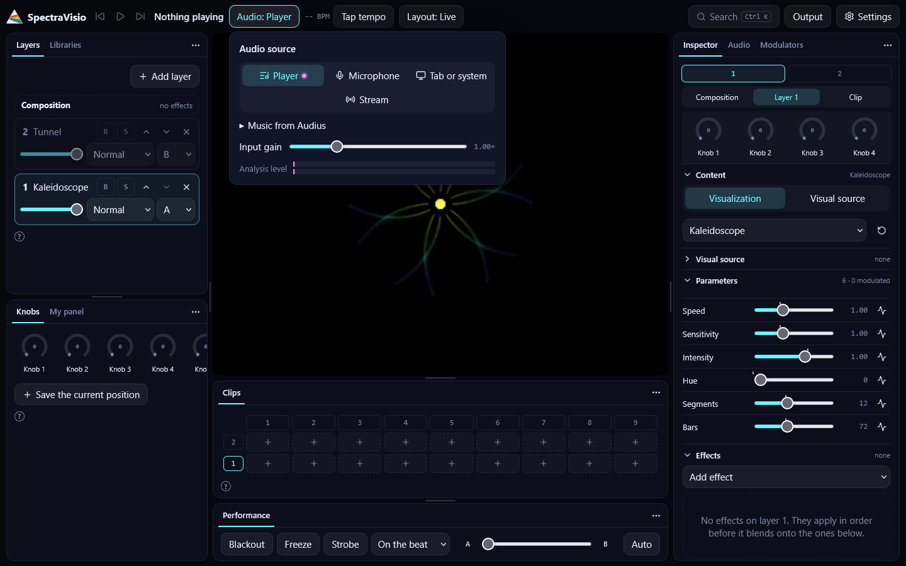

# Play music and pick a source

SpectraVisio reacts to whatever sound it analyses. That can be a track in its own player or a live input.

## Play your files

Open the **Audio** tab on the right. **Add files** or **Add folder** fill the queue; you can also drop files or folders on it.

- Press **Play** or `Space`. `Shift` + `→` and `Shift` + `←` change track, `→` and `←` jump 5 seconds
- **Crossfade between tracks** blends one track into the next, and **Level volume** brings them all to the same loudness; without crossfade, tracks play without a gap between them
- Drag a track to reorder the queue; shuffle and repeat are next to the play button
- Title, artist and cover come from the tags of the file. The queue survives a reload; to keep the files themselves, turn on **Settings › General › Keep the files in the app**
- Each track is analysed in the background for its tempo and sections, and its BPM shows in the queue

## Use another source

The **Audio: Player** button in the top bar changes what is analysed.

- **Microphone:** pick the device, and set the input gain below
- **Tab or system:** share a tab or the whole system with its audio. Chrome and Edge only; turn on the audio sharing in the browser's dialog
- **Stream:** an internet radio, from the directory or any stream address. The server has to allow CORS
- **Music from Audius:** search tracks by independent artists and add them to the queue

With a live input, the visuals follow the sound but there is no queue. If the input is silent for a few seconds, the app says so.

## Tempo and latency

The **Analysis** panel under the queue shows the bands and the beats. **Tap tempo** (the top bar button, or `T`) sets the BPM by hand and **Back to estimate** returns to the automatic one. If the image arrives a little early or late, the latency can be compensated there too.

## Lyrics and covers

Synced lyrics can come from LRC files. For tracks without lyrics or a cover, the app can look them up on LRCLIB and MusicBrainz, but only if you turn it on in **Settings › Online**: the artist, title and duration of the song playing are sent to those sites. It is off by default.
